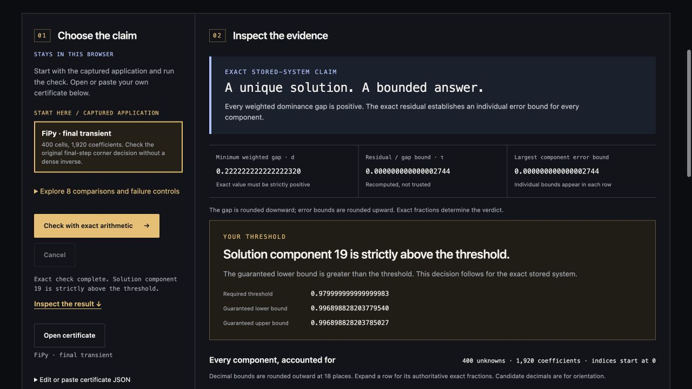

# Certloom

**Send a numerical answer that someone else can check.**

Check a captured diffusion result in your browser, download its equations and error-bound checker, and verify the bundle with plain Python. The recipient needs no FiPy, NumPy or producing solver. The guarantee concerns the **stored linear equations**, not the physical model's accuracy.

**[Open the browser lab](https://nazeeh111.github.io/Certloom/)** · [Download a ready-to-check proof](https://github.com/nazeeh111/Certloom/releases/download/v0.2.0/certloom-0.2.0-diffusion-proof.zip) · [Method and limits](https://nazeeh111.github.io/Certloom/docs/method.html)

## Try the complete handoff

1. **Check in the browser.** Choose **FiPy · steady state**, then **Check with exact arithmetic**. Inspect the bounds on all 400 solution components and the separate threshold decision.
2. **Export the evidence.** Choose **Download portable proof .zip**. The bundle contains the input, result, standalone checker and instructions.
3. **Verify elsewhere.** Extract the ZIP into a new directory and run the command below there. Only Python 3.10+ and its standard library are needed; Certloom itself does not need to be installed.

```sh
python3 -I -S checker.py certificate.json
```

The checker recomputes the claim instead of trusting the saved result. Compare its output with the `result` field in `verification.json`. To try the recipient step immediately, use the ready-to-check proof linked above.



[](https://github.com/nazeeh111/Certloom/actions/workflows/check.yml)
[](https://github.com/nazeeh111/Certloom/releases/latest)
[](https://nazeeh111.github.io/Certloom/docs/method.html)
[](LICENSE)

The browser runs a separate BigInt implementation locally in a Web Worker. No account, CDN, runtime download or computation service. Dense certificates with an approximate inverse remain supported.

## Check an application result

Open the lab and choose **FiPy · final transient**. These are the actual equations, right-hand side and answer captured from the final transient solve of NIST's two-dimensional diffusion example. Inspect the 400 component enclosures and the bottom-right cell's strict threshold, above 0.98. Its enclosure also lies inside the example's [0.99, 1.01] tolerance interval.

Choose **FiPy · steady state** to check the subsequent steady solve. Both matrices have 400 rows and 1,920 nonzeros. The steady case uses nonuniform positive weights. **When weights fail** supplies unit weights for that same system: the minimum dominance gap is zero, so this proof refuses. **A changed answer** replaces a candidate component with zero: the wider valid enclosure cannot establish the original threshold. A certified enclosure and a useful decision are separate outcomes.

Proof bundles retain the NIST attribution and terms in `NOTICES.txt`, separate from Certloom's MIT license. The ready-to-check proof linked above contains the steady-state example.

This verifies the **exact stored binary64 linear system**. The final transient right-hand side includes a previous approximate time state. It does not certify accumulated time-stepping error, PDE discretization accuracy or physical measurements.

## Install or use the source

Python 3.10 or later. Download `certloom-0.2.0-py3-none-any.whl` and install without runtime dependencies:

```sh
python3 -m pip install --no-deps certloom-0.2.0-py3-none-any.whl
certloom --version
certloom build-site --out certloom-lab
python3 -m http.server 8000 --bind 127.0.0.1 --directory certloom-lab
```

Visit `http://127.0.0.1:8000`. The release also includes `certloom-0.2.0-browser.zip` for static hosting. To work directly from the complete source ZIP:

```sh
unzip certloom-0.2.0-source.zip
cd certloom-0.2.0
python3 -m certloom verify examples/fipy-transient400.json
python3 -m certloom bundle examples/fipy-steady400.json --out fipy-proof.zip
```

Installed commands also accept any certificate path:

```sh
certloom verify certificate.json
certloom bundle certificate.json --out proof.zip
```

All output destinations must be new. Existing files or directories refuse without being overwritten. `verify` and the standalone checker return **0** for a certified enclosure, **3** when the method's proof premise fails, and **2** for invalid input or a file error. A certified enclosure may still have an `undecidable` threshold. Successful `bundle` returns 0 for writing an artifact, including one recording a refused proof.

## Bring your sparse solver

Supply the actual square system `A`, right-hand side `b`, candidate `x` and positive weights. **CSR**, compressed sparse row storage, uses `indptr` to mark each row's start, `indices` for column numbers and `data` for the corresponding nonzero values. No approximate inverse is required.

```python
import json
from certloom.producer import make_sparse_certificate

# Arrays from your producer; columns must already be sorted within each row.
document = make_sparse_certificate(
    indptr, indices, data, b, x, weights,
    decision={"index": 19, "above": 0.98},
)
with open("certificate.json", "x", encoding="utf-8") as stream:
    json.dump(document, stream)
```

The decision is optional; choose an index and threshold meaningful for your system. The function infers dimension from `b`, converts coefficient values explicitly to finite binary64 and encodes canonical Python `float.hex()` strings. It accepts integer index arrays, including NumPy integer scalars, without importing NumPy. It does not sort columns, combine duplicates, remove zeros, choose weights or run a solver. The checker validates the document again.

Rows require strictly increasing, in-range columns. Duplicate coordinates, explicit zero entries and nonpositive weights refuse. Missing entries mean zero; an empty row or missing diagonal can be valid input but cannot pass this proof. The [format guide](https://nazeeh111.github.io/Certloom/docs/method.html) gives the complete schema and result fields.

## What the sparse check proves

For the exact stored real system `A x* = b`, with every weight `wi > 0`, recompute:

```text
di    = |aii| wi − sum(j ≠ i) |aij| wj
ri    = bi − sum(j) aij xj
tau   = max(i) |ri| / di, provided every di > 0
|x*i − xi| ≤ wi tau
x*i ∈ [xi − wi tau, xi + wi tau]
```

Strict weighted diagonal dominance is an established sufficient condition for a unique solution. Every gap and residual is checked exactly; supplied weights are untrusted. Failed weights do not establish singularity or an incorrect answer. This is a restricted certificate method, not a general sparse solver. Checking uses arithmetic operations proportional to rows plus nonzeros; exact integer bit sizes also affect cost. The 400-cell example establishes no large-scale performance claim.

For a strict threshold `x*i > t`, a lower endpoint above `t` establishes `above`; an upper endpoint at or below `t` establishes `not_above`; otherwise the result is `undecidable`. Exact rational records are authoritative. Displayed endpoints round outward, so formatting cannot narrow an enclosure or decide a threshold.

## Dense certificates remain available

`make_certificate(A, b, x, R, decision=None)` retains the original dense format. Any producer may supply an approximate inverse `R`. The checker recomputes `q = ||I − RA||∞` and `eta = ||R(b − Ax)||∞`; when `q < 1`, every component has radius `eta / (1 − q)`. The infinity norm is the largest absolute row sum for a matrix or absolute component for a vector. Failed contraction returns `not_certified`.

The original ideal 64-node resistor ladder, Hilbert examples and labeled controls remain in the lab. **Small residual, failed proof** shows why a tiny floating residual alone does not establish accuracy. The ladder models declared equations, not measured hardware; `certloom-0.2.0-ladder-proof.zip` remains available.

## Boundaries and evidence

- Sparse: 1–4,096 unknowns and at most 32,768 nonzeros, with no dense expansion. Dense: 1–128 unknowns and cubic checking. Both accept at most 2 MiB of UTF-8 JSON.
- Coefficients mean their exact represented binary64 values. Intended decimals, coefficient uncertainty, model truth, solver execution and the full simulation trajectory are outside the claim.
- Input is data only. Nonfinite/noncanonical values, duplicate keys, extra fields, malformed indices and expressions refuse. Uploaded code is never executed.
- This is executable verification using established theorems, not a proof checked by a formal proof assistant. Inspect the checker source. SHA-256 identifies bytes; it does not authenticate a producer or checker.
- The lab needs localhost HTTP or HTTPS. Module workers do not run from `file://`; export hashing requires a secure context. Cancel and a 20-second deadline terminate the active worker. Editing input revokes the previous claim and exports. The standalone command has no browser deadline.

The FiPy fixtures come from one execution of the unchanged [NIST example](https://github.com/usnistgov/fipy/blob/d8f038a0663d7b2b1c716761ae2eed0e57e1c7c2/examples/diffusion/mesh20x20.py), pinned at `d8f038a0663d7b2b1c716761ae2eed0e57e1c7c2`, with FiPy 4.0.3, NumPy 2.3.5 and SciPy 1.18.1. Both original corner checks passed. The captured final transient and steady systems were independently checked with exact fractions. The steady weights came from one solve of the comparison matrix against ones; this witness solve does not replace the application's right-hand side.

[FiPy provenance](examples/fipy-provenance.json) records source, capture, hashes, controls and scope. The [unchanged source](examples/fipy-mesh20x20.py), [NIST terms](examples/FIPY-TERMS.txt) and [attribution](examples/FIPY-NOTICE.txt) accompany the data. FiPy produces these examples; it is not a package or checker dependency. Original dense fixtures and their separate analytic/rational checks remain documented in [examples/manifest.json](examples/manifest.json) and [examples/validation.json](examples/validation.json).

[INTLAB 14.1](https://www.tuhh.de/ti3/rump/intlab/) already provides broader sparse verified solves. [FLINT/Arb](https://flintlib.org/doc/index_arb.html) provides rigorous ball arithmetic, including uncertain inputs and adjustable precision. Certloom focuses on a solver-independent portable handoff and two separately implemented checkers. It does not claim new mathematics or replace these environments.

## Develop

```sh
python3 -m unittest discover -s tests -v
node --test tests/test_web_verify.cjs tests/test_web_lifecycle.cjs tests/test_web_sparse.cjs
python3 scripts/package.py --out dist
python3 scripts/check_installed.py --wheel dist/certloom-0.2.0-py3-none-any.whl
```

The verifier needs no third-party Python runtime packages. Node runs the separate JavaScript checks. Source builds use setuptools; the release packager also has a standard-library path. [MIT licensed](LICENSE), with the NIST example notices retained. Developed and reviewed with Codex. See [SECURITY.md](SECURITY.md) for reporting implementation defects.
