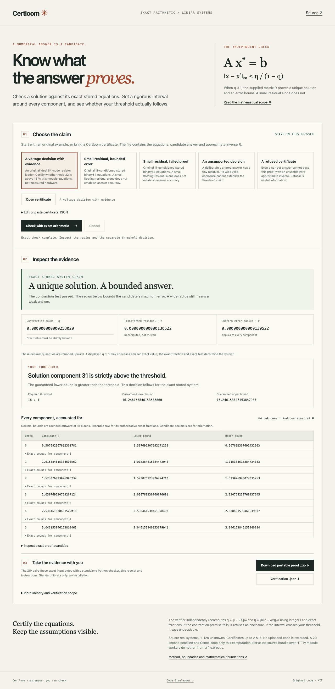

# Certloom

**Send a numerical answer with a checker that proves its error bound.**

[Try the browser lab](https://nazeeh111.github.io/Certloom/) · [Download a release](https://github.com/nazeeh111/Certloom/releases) · [Method and scope](https://nazeeh111.github.io/Certloom/docs/method.html)

Your solver proposes an answer. Certloom independently checks the stored equations with exact arithmetic, encloses every solution component, and determines whether a threshold follows. Export the input, result and a standalone Python checker. The recipient needs only the Python standard library, without your solver or environment.

The browser lab runs a separate BigInt implementation locally in a Web Worker. No account, CDN, runtime download or computation service.



## Try a result worth checking

Open the lab and choose **A voltage decision with evidence**. An original ideal 64-node resistor ladder asks whether node 32 exceeds 16 V. Certloom proves a unique solution, encloses every node and establishes the threshold. Download its portable proof and run:

```sh
python3 -I -S checker.py certificate.json
```

Compare the output with the `result` field in `verification.json`. It recomputes the claim; it does not trust the receipt. The example models declared equations, not measured hardware.

Then choose **Small residual, failed proof**. The Hilbert12 candidate has a tiny floating-point residual, but its supplied approximate inverse fails the proof premise. Certloom refuses an enclosure. **An unsupported decision** demonstrates another distinction: an enclosure can be mathematically valid yet too wide to establish a threshold.

## Install and use

Python 3.10 or later. Download `certloom-0.1.0-py3-none-any.whl` from the release and install it without runtime dependencies:

```sh
python3 -m pip install --no-deps certloom-0.1.0-py3-none-any.whl
certloom --version
certloom verify certificate.json
certloom bundle certificate.json --out proof.zip
certloom build-site --out certloom-lab
python3 -m http.server 8000 --bind 127.0.0.1 --directory certloom-lab
```

Visit `http://127.0.0.1:8000`. The release also includes a static browser ZIP and a ready-to-run ladder proof ZIP. All output destinations must be new: existing files or directories refuse without being overwritten.

`verify` and the standalone checker return **0** for a certified enclosure, **3** when the contraction premise fails, and **2** for invalid input or a file error. A certified enclosure may still have an `undecidable` threshold. Successful `bundle` returns 0 for writing an artifact, including an artifact recording a refused proof.

## Bring your solver

Supply a square matrix `A`, right-hand side `b`, candidate `x` and approximate inverse `R`. Any producer may supply them. For example, with NumPy installed in your producer environment:

```python
import json
import numpy as np
from certloom.producer import make_certificate

A = np.array([[2.0, -1.0], [-1.0, 2.0]])
b = np.array([1.0, 0.0])
x = np.linalg.solve(A, b)
R = np.linalg.inv(A)
document = make_certificate(A, b, x, R, {"index": 0, "above": 0.5})
with open("certificate.json", "x", encoding="utf-8") as stream:
    json.dump(document, stream)
```

NumPy is optional and belongs to the producer. The verifier uses no NumPy. `make_certificate` explicitly converts coefficients to finite binary64 values and encodes canonical `float.hex()` strings. Upload the resulting JSON to the lab or use the CLI. The [format guide](https://nazeeh111.github.io/Certloom/docs/method.html) describes the exact schema and refusal conditions.

## What the check establishes

For the exact stored real system `A x* = b`, Certloom recomputes:

```text
q   = ||I − RA||∞
η   = ||R(b − Ax)||∞
r   = η / (1 − q), provided q < 1
x*i ∈ [xi − r, xi + r], for every component i
```

Here `||·||∞` is the largest absolute row sum for a matrix, or largest absolute component for a vector. The established Neumann-series inverse bound proves a unique solution and the stated enclosure when `q < 1`. A supplied `R` need not be trusted or accurate: it must pass the recomputed premise.

For a requested strict threshold `x*i > t`, the exact lower endpoint above `t` establishes `above`; an upper endpoint at or below `t` establishes `not_above`; otherwise the result is `undecidable`. If `q ≥ 1`, this method returns `not_certified`. That does not imply that the system is singular or the answer is wrong.

The two engines compute with integers and exact fractions. Exact fraction records are authoritative. Displayed lower and upper decimals round outward, so formatting cannot narrow an enclosure or decide a threshold.

## Boundaries that matter

- Square real systems, 1–128 unknowns; JSON at most 2 MiB. Dense checking takes cubic work. This is a bounded portable check, not a large sparse solver.
- Equations mean the **exact represented binary64 values**. Intended decimal coefficients, measurement uncertainty, physical assumptions and the original solver's execution are outside the claim.
- This is executable numerical verification using an established theorem, not a proof checked by a formal proof assistant. Inspect and trust the checker implementation accordingly.
- SHA-256 identifies input bytes. It does not authenticate their producer, the site or a downloaded checker.
- Input is data only. Nonfinite/noncanonical coefficients, duplicate keys, unexpected fields, unsupported dimensions and expressions refuse. Uploaded code is never executed.
- The lab needs localhost HTTP or HTTPS. Module workers do not work from `file://`; export hashing requires a secure browser context. Cancel and a 20-second deadline terminate only the active worker. Editing input revokes the previous displayed claim and exports.

## Evidence and foundations

The five included fixtures were originally generated with NumPy 2.3.5. Their equations, producer identity, byte hashes and exact validation results are in [examples/manifest.json](examples/manifest.json) and [examples/validation.json](examples/validation.json). The ladder is independently checked against its analytic solution at all 64 nodes; the smaller systems use a separate rational elimination oracle. The altered-answer and zero-inverse controls are labeled explicitly. Regenerate in a producer environment with `python scripts/generate_examples.py --out NEW_DIRECTORY`.

Tests compare Python and JavaScript results exactly, including extreme exponents, subnormals, threshold boundaries and malformed-input refusal. Artifact checks execute the detached checker with `-I -S`, verify ZIP contents, and check that existing outputs remain intact. Controlled lifecycle tests exercise cancellation, deadlines and stale messages; those tests use fake workers and do not establish browser execution. CI additionally installs the release wheel into a fresh environment and exercises its packaged lab resources and exports.

Validated numerics has strong existing foundations, including [Rump's work and INTLAB](https://www.tuhh.de/ti3/rump/intlab/) and [Arb](https://arblib.org/). Certloom's contribution is a small, solver-independent handoff, two separately implemented checkers and a clear threshold workflow. It does not claim to invent rigorous numerical bounds or replace broader interval-arithmetic systems.

## Develop

```sh
python3 -m unittest discover -s tests -v
node --test tests/test_web_verify.cjs tests/test_web_lifecycle.cjs
python3 scripts/package.py --out dist
python3 scripts/check_installed.py --wheel dist/certloom-0.1.0-py3-none-any.whl
```

The verifier and tests require Python and Node, without third-party Python runtime packages. Source builds use setuptools; release packaging also has a standard-library path. [MIT licensed](LICENSE). See [SECURITY.md](SECURITY.md) for reporting implementation defects.
