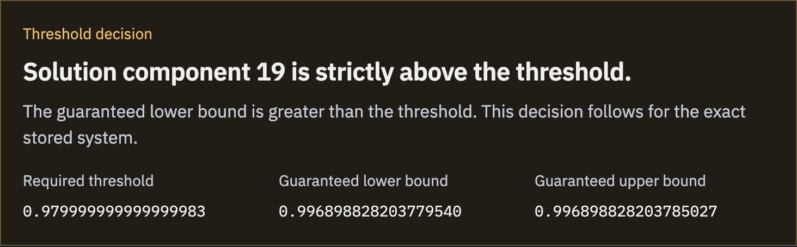
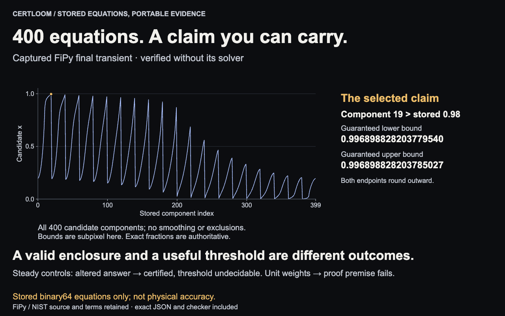

# Certloom

**Carry the equations with the answer. Let the recipient check the claim.**

Check a numerical answer against its stored equations. Inspect exact error bounds, then export a proof a recipient can recheck with plain Python.

[Open the workbench](https://nazeeh111.github.io/Certloom/) · [Verify a received proof](#verify-a-received-bundle) · [Method and limits](https://nazeeh111.github.io/Certloom/docs/method.html)

<picture>
  <source media="(max-width: 600px)" srcset="docs/workbench/decision-mobile.png">
  
</picture>

The real decision section for the retained **400-equation FiPy example**. Exact fractions determine the verdict. [Capture sizes, source and scope](docs/workbench/README.md).

## Verify the artifact, then interpret the result

1. **Check.** Open the workbench, choose **FiPy · final transient**, then **Check certificate**. The threshold decision comes before its supporting proof metrics.
2. **Inspect.** Enter an index and choose **Show** to read its candidate, guaranteed bounds and exact fractions. The full paginated table remains available. [Actual component 399 view](docs/workbench/component-399-mobile.png).
3. **Share.** Choose **Download proof .zip**. Use a separately installed matching current-source Certloom to recompute its claim without executing archive code:

```sh
certloom verify-bundle certloom-proof.zip
```

Or check the [retained six-member `transient-proof.zip`](docs/presentation/transient-proof.zip), substituting that filename.

The check covers the **exact stored binary64 equations**, not discretization error, the full time-stepping trajectory or a physical measurement. A certified enclosure can still leave a threshold undecidable; failed proof weights do not prove singularity. [Executed recipient and tamper checks](docs/presentation/handoff-checks.json) · [Install from current source](#install-or-use-the-source).

<details>
<summary>Captured equations, all 400 bounds and the retained handoff</summary>

## Check an application result

Open the lab and choose **FiPy · final transient**. These are the actual equations, right-hand side and answer captured from the final transient solve of NIST's two-dimensional diffusion example. Inspect the 400 component enclosures and the bottom-right cell's strict threshold, above 0.98. Its enclosure also lies inside the example's [0.99, 1.01] tolerance interval.

Choose **FiPy · steady state** to check the subsequent steady solve. Both matrices have 400 rows and 1,920 nonzeros. The steady case uses nonuniform positive weights. **When weights fail** supplies unit weights for that same system: the minimum dominance gap is zero, so this proof refuses. **A changed answer** replaces a candidate component with zero: the wider valid enclosure cannot establish the original threshold. A certified enclosure and a useful decision are separate outcomes.

Proof bundles retain the NIST attribution and terms in `LICENSE-FIPY.txt`, separate from Certloom's MIT license. The [historical v0.2.0 ready-to-check proof](https://github.com/nazeeh111/Certloom/releases/download/v0.2.0/certloom-0.2.0-diffusion-proof.zip) contains the steady-state example. The current-source proof downloads above contain the final transient example.

This verifies the **exact stored binary64 linear system**. The final transient right-hand side includes a previous approximate time state. It does not certify accumulated time-stepping error, PDE discretization accuracy or physical measurements.


<picture>
  <source media="(max-width: 600px)" srcset="docs/presentation/proof-mobile.png">
  
</picture>

The actual handoff contains **400 equations and 1,920 stored coefficients**. A fresh trusted checker recomputes every dominance gap and residual, then verifies all 400 enclosures. Component 19 has outward-rounded bounds **[0.996898828203779540, 0.996898828203785027]**, enough to establish the strict stored 0.98 threshold. The line plot shows stored index order, not a spatial field or physical measurement. [Exact results and reproducible figure](docs/presentation/README.md).

[Full-resolution wide SVG](docs/presentation/proof.svg) · [Portrait SVG](docs/presentation/proof-mobile.svg) · [Figure source, exact data and terms](docs/presentation/README.md).

The [completed recipient checks](docs/presentation/handoff-checks.json) independently verify both CLI and real browser downloads, then compare fresh extracted `python3 -I -S checker.py certificate.json` runs after establishing trust in the extracted checker. Rehashed receipt or checker alterations refuse. Checksums establish byte consistency, not authorship.

**A certified enclosure is not always a useful answer.** The separate steady-state changed-answer control remains certified but its threshold is `undecidable`; unit weights fail the proof premise. Neither refusal proves the matrix singular or the candidate wrong. [Actual outcomes, commands and limits](docs/presentation/README.md).

Earlier pinned-source captures remain available: [desktop workbench](docs/presentation/workbench-desktop.png) · [390px bounds view](docs/presentation/workbench-mobile.png). Their original source and actions are documented in the retained handoff record; the new decision and component captures above use the current workbench.

</details>

<details>
<summary>Installation, producer APIs, exact methods and development</summary>

## Install or use the source

Certloom is the product, package and command name. The current source is unreleased `0.2.1.dev0`. The historical 0.2.0 wheel and proof retain their original checker and bundle format.

Python 3.10 or later. From a current source checkout, install the current package without runtime dependencies:

```sh
python3 -m pip install --no-deps .
certloom --version
certloom build-site --out certloom-lab
python3 -m http.server 8000 --bind 127.0.0.1 --directory certloom-lab
```

Visit `http://127.0.0.1:8000`. The historical v0.2.0 release also includes its own wheel, browser ZIP and source ZIP. It predates the current bundle-verification command; use its original instructions and matching checker. To work from that historical source ZIP:

```sh
unzip certloom-0.2.0-source.zip
cd certloom-0.2.0
python3 -m certloom verify examples/fipy-transient400.json
python3 -m certloom bundle examples/fipy-steady400.json --out fipy-proof.zip
```

Installed commands also accept any certificate path:

```sh
certloom verify certificate.json
certloom bundle certificate.json --out proof.zip
```

All output destinations must be new. Existing files or directories refuse without being overwritten. `verify` and the standalone checker return **0** for a certified enclosure, **3** when the method's proof premise fails, and **2** for invalid input or a file error. A certified enclosure may still have an `undecidable` threshold. Successful `bundle` returns 0 for writing an artifact, including one recording a refused proof.

## Bring your sparse solver

Supply the actual square system `A`, right-hand side `b`, candidate `x` and positive weights. **CSR**, compressed sparse row storage, uses `indptr` to mark each row's start, `indices` for column numbers and `data` for the corresponding nonzero values. No approximate inverse is required.

```python
import json
from certloom.producer import make_sparse_certificate

# Arrays from your producer; columns must already be sorted within each row.
document = make_sparse_certificate(
    indptr, indices, data, b, x, weights,
    decision={"index": 19, "above": 0.98},
)
with open("certificate.json", "x", encoding="utf-8") as stream:
    json.dump(document, stream)
```

The decision is optional; choose an index and threshold meaningful for your system. The function infers dimension from `b`, converts coefficient values explicitly to finite binary64 and encodes canonical Python `float.hex()` strings. It accepts integer index arrays, including NumPy integer scalars, without importing NumPy. It preserves explicit weights and the supplied matrix structure. The checker validates the document again.

Omit `weights` to search for a sufficient scaling. An existing sparse certificate
can also be reweighted without changing its equations, candidate solution or decision:

```sh
certloom reweight examples/fipy-uniform-refusal.json --out reweighted.json
certloom verify reweighted.json
```

Unit weights fail on this steady 400-equation example. The search finds weights
that the exact verifier accepts, establishing that component 19 exceeds the
stored threshold. It first tries unit weights, then up to 256 sparse
Gauss-Seidel sweeps on the comparison matrix. Successful supplied weights
are preserved. Search exhaustion leaves the output path free and the system's
invertibility undecided. Exported certificates use the existing sparse format.

Rows require strictly increasing, in-range columns. Duplicate coordinates, explicit zero entries and nonpositive weights refuse. Missing entries mean zero; an empty row or missing diagonal can be valid input but cannot pass this proof. The [format guide](https://nazeeh111.github.io/Certloom/docs/method.html) gives the complete schema and result fields.

## What the sparse check proves

For the exact stored real system `A x* = b`, with every weight `wi > 0`, recompute:

```text
di    = |aii| wi − sum(j ≠ i) |aij| wj
ri    = bi − sum(j) aij xj
tau   = max(i) |ri| / di, provided every di > 0
|x*i − xi| ≤ wi tau
x*i ∈ [xi − wi tau, xi + wi tau]
```

Strict weighted diagonal dominance is an established sufficient condition for a unique solution. Every gap and residual is checked exactly; supplied weights are untrusted. Failed weights do not establish singularity or an incorrect answer. This is a restricted certificate method, not a general sparse solver. Checking uses arithmetic operations proportional to rows plus nonzeros; exact integer bit sizes also affect cost. The 400-cell example establishes no large-scale performance claim.

For a strict threshold `x*i > t`, a lower endpoint above `t` establishes `above`; an upper endpoint at or below `t` establishes `not_above`; otherwise the result is `undecidable`. Exact rational records are authoritative. Displayed endpoints round outward, so formatting cannot narrow an enclosure or decide a threshold.

## Dense certificates remain available

`make_certificate(A, b, x, R, decision=None)` retains the original dense format. Any producer may supply an approximate inverse `R`. The checker recomputes `q = ||I − RA||∞` and `eta = ||R(b − Ax)||∞`; when `q < 1`, every component has radius `eta / (1 − q)`. The infinity norm is the largest absolute row sum for a matrix or absolute component for a vector. Failed contraction returns `not_certified`.

The original ideal 64-node resistor ladder, Hilbert examples and labeled controls remain in the lab. **Small residual, failed proof** shows why a tiny floating residual alone does not establish accuracy. The ladder models declared equations, not measured hardware; `certloom-0.2.0-ladder-proof.zip` remains available.

## Boundaries and evidence

- Sparse: 1–4,096 unknowns and at most 32,768 nonzeros, with no dense expansion. Dense: 1–128 unknowns and cubic checking. Both accept at most 2 MiB of UTF-8 JSON.
- Coefficients mean their exact represented binary64 values. Intended decimals, coefficient uncertainty, model truth, solver execution and the full simulation trajectory are outside the claim.
- Input is data only. Nonfinite/noncanonical values, duplicate keys, extra fields, malformed indices and expressions refuse. Uploaded code is never executed.
- This is executable verification using established theorems, not a proof checked by a formal proof assistant. Inspect the checker source. SHA-256 identifies bytes; it does not authenticate a producer or checker.
- The lab needs localhost HTTP or HTTPS. Module workers do not run from `file://`; export hashing requires a secure context. Cancel and a 20-second deadline terminate the active worker. Editing input revokes the previous claim and exports. The standalone command has no browser deadline.

The FiPy fixtures come from one execution of the unchanged [NIST example](https://github.com/usnistgov/fipy/blob/d8f038a0663d7b2b1c716761ae2eed0e57e1c7c2/examples/diffusion/mesh20x20.py), pinned at `d8f038a0663d7b2b1c716761ae2eed0e57e1c7c2`, with FiPy 4.0.3, NumPy 2.3.5 and SciPy 1.18.1. Both original corner checks passed. The captured final transient and steady systems were independently checked with exact fractions. The steady weights came from one solve of the comparison matrix against ones; this witness solve does not replace the application's right-hand side.

[FiPy provenance](examples/fipy-provenance.json) records source, capture, hashes, controls and scope. The [unchanged source](examples/fipy-mesh20x20.py) and [NIST terms and source attribution](examples/FIPY-TERMS.txt) accompany the data. FiPy produces these examples; it is not a package or checker dependency. Original dense fixtures and their separate analytic/rational checks remain documented in [examples/manifest.json](examples/manifest.json) and [examples/validation.json](examples/validation.json).

Certloom uses established mathematics for a solver-independent portable handoff with two separately implemented checkers.

## Develop

```sh
python3 -m unittest discover -s tests -v
node --test tests/test_web_verify.cjs tests/test_web_lifecycle.cjs tests/test_web_sparse.cjs
python3 scripts/package.py --out dist
python3 scripts/check_installed.py --wheel dist/certloom-0.2.1.dev0-py3-none-any.whl
```

The verifier needs no third-party Python runtime packages. Node runs the separate JavaScript checks. Source builds use setuptools; the release packager also has a standard-library path. [MIT licensed](LICENSE), with the NIST example notices retained. See [SECURITY.md](SECURITY.md) for reporting implementation defects.

### Verify a received bundle

Run `certloom verify-bundle proof.zip` to check the member set and receipt,
compare the bundled checker to this installation, and recompute with the installed
exact engine. Archive code is never executed. Six-member bundles include checked
SHA-256 values; older browser bundles have five members and report checksums
`absent` while still receiving the same receipt and mathematical checks. These
checks establish byte consistency and exact stored-system results, not who
produced the archive. Bundles with a checker from another installed version are
refused; use the matching trusted release. Unsupported archive formats and
oversized inputs are refused. Output publication requires hard-link support in
the destination filesystem and never replaces an existing path.

</details>
